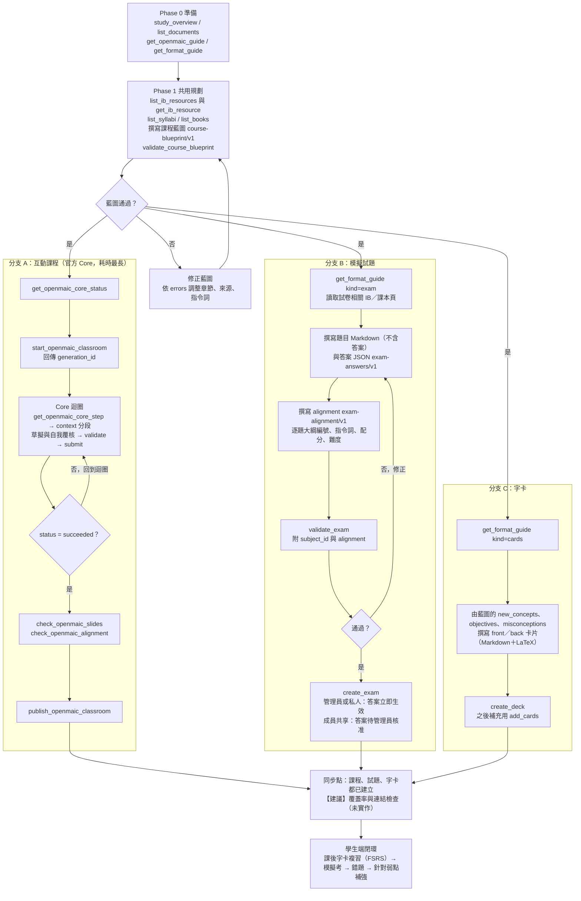
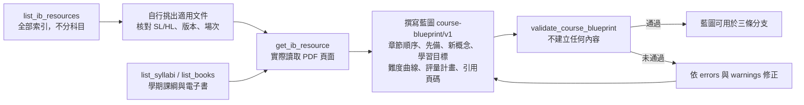
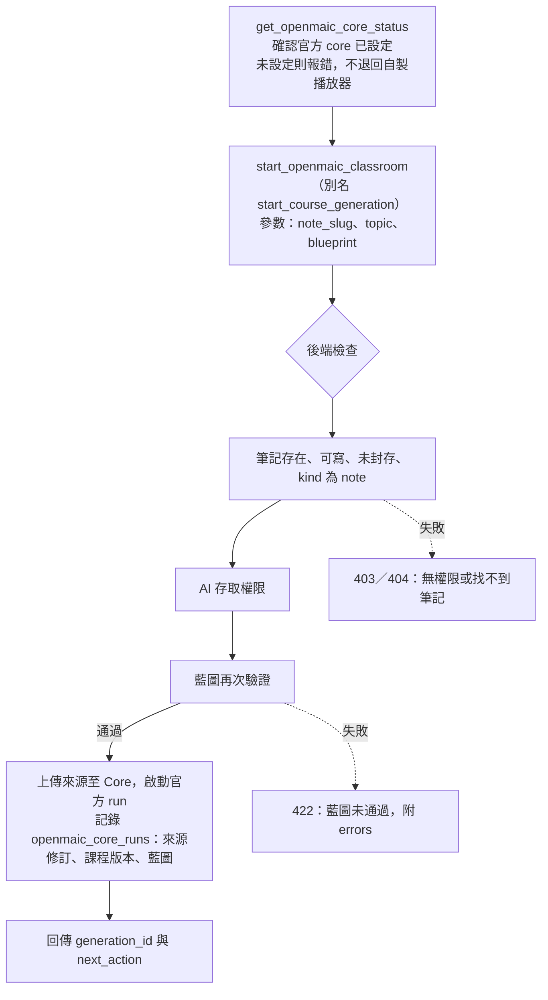
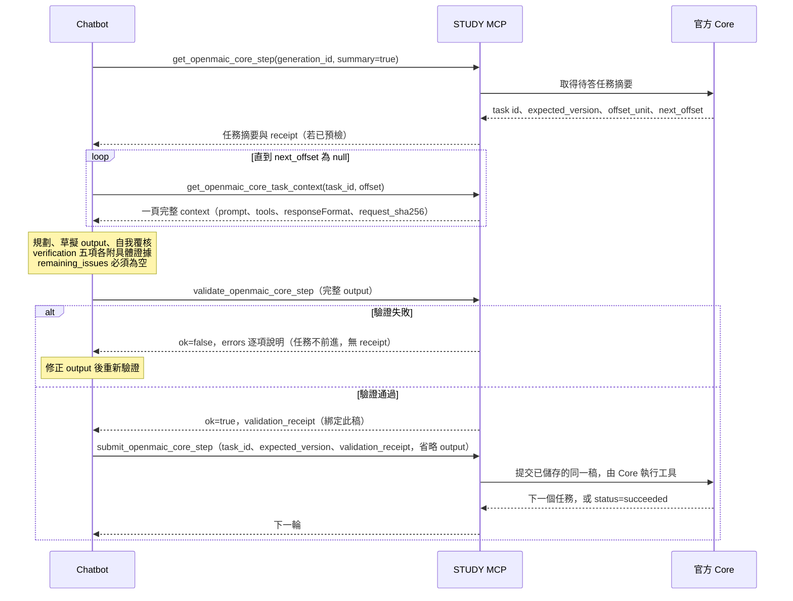
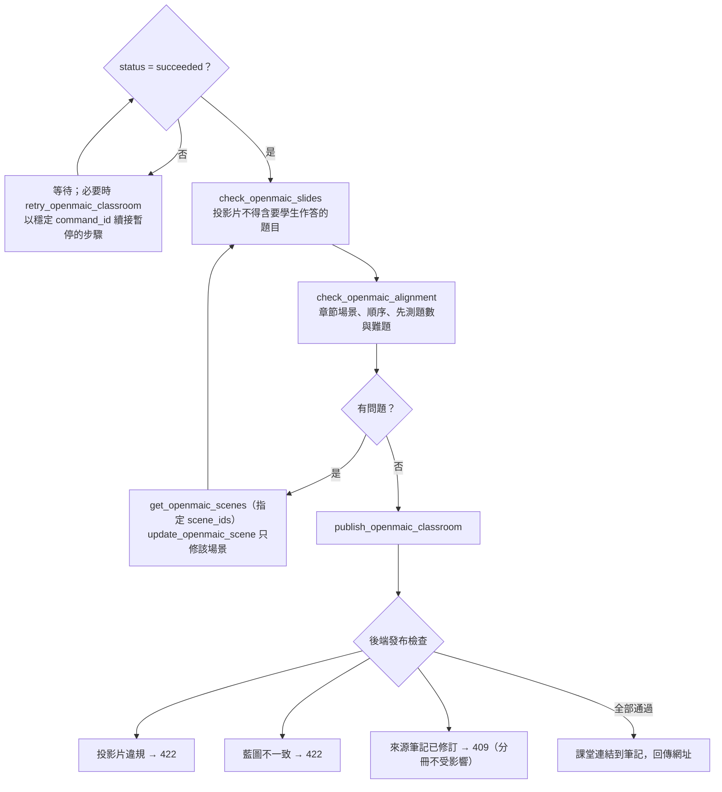
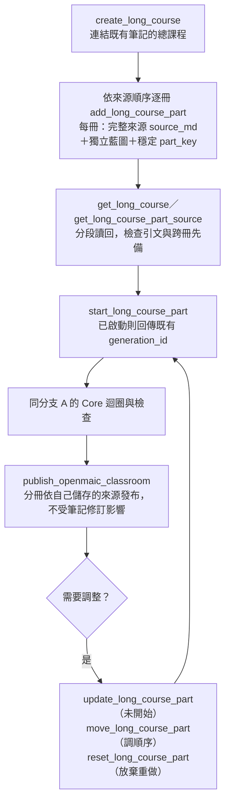
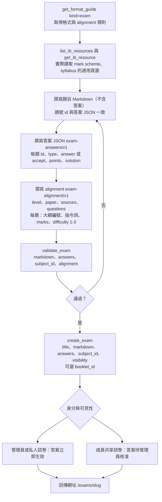
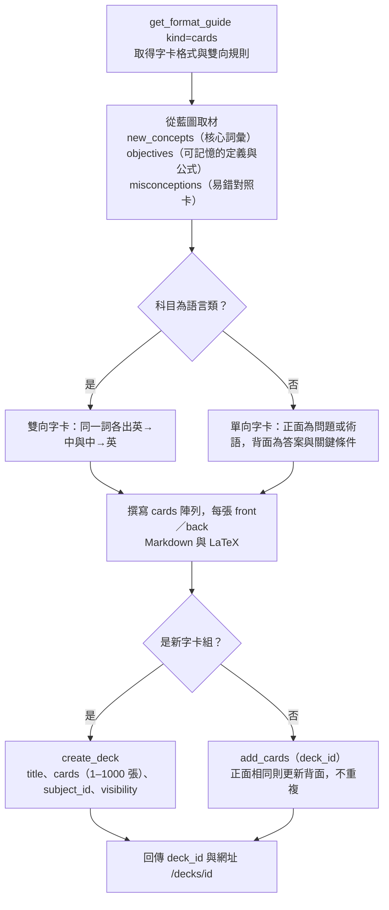

# 課程生成與同步產出模擬試題、字卡的完整流程

本文件描述透過 STUDY MCP，由 chatbot 生成三種成品的完整流程：

1. **互動課程**（完整官方 OpenMAIC core，分支 A）
2. **模擬試題**（`create_exam`，分支 B）
3. **字卡組**（`create_deck` / `add_cards`，分支 C）

三者共用同一份**課程藍圖**（course blueprint）作為規劃起點，課程生成耗時最長，試題與字卡可以與它並行。

> **狀態標示**：本文件依程式碼與既有文件整理。標示 **【現行】** 的是程式已實作的行為；標示 **【建議】** 的是目前尚未實作、為串起三條分支而提出的步驟，實作前不應視為既有功能。

---

## 0. 角色與元件

| 角色 | 說明 |
|---|---|
| 使用者 | 指定來源筆記、科目、主題，並決定可見性（私人／共享） |
| Chatbot | 透過 MCP 讀取文件、撰寫藍圖、草擬內容、自我覆核、提交 |
| STUDY MCP | `src/worker/mcp/server.ts`，對外的工具介面，同時是 chatbot 的「閘門」 |
| STUDY Worker + D1 | `src/worker/routes/openmaic-core.ts`、`exams.ts`、`decks.ts`，負責權限、驗證、儲存 |
| 官方 OpenMAIC Core | 生成大綱、場景、互動模組與編譯；模型回合交由 chatbot 回答 |
| IB 參考文件 | 管理員上傳的 syllabus、guideline、mark scheme（不分科目，由 chatbot 依名稱與版本挑選） |
| 學生 | 學習課堂、複習字卡（FSRS 排程）、作答模擬考 |

**重要前提**：沒有任何單一工具能「一次生成課程、試題與字卡」。所謂「同時連帶生成」是 chatbot 依本文件的順序編排多個工具呼叫；三條分支只靠**共用藍圖與 IB 文件**在規劃層面對齊，伺服器不會自動把三者連結起來。

---

## 1. 總覽流程圖



**並行的意義**：分支 A 在官方 Core 上需要多輪模型回合，可能跨越多次對話；分支 B、C 只依賴藍圖與 IB 文件，不需要等課程完成。建議先完成藍圖，再依序或並行進行三條分支。

---

## 2. Phase 0：準備

| 步驟 | 工具 | 說明 |
|---|---|---|
| 0-1 | `study_overview` | 取得 `subject_id`、科目清單、考試日程與字卡到期數。建立內容前必呼叫 |
| 0-2 | `list_documents` | 找到使用者指定或既有的重點整理作為**來源筆記**。沒有合適來源時請使用者選擇，**不要**為藍圖或流程另建「種子」筆記 |
| 0-3 | `get_openmaic_guide` | 讀取課程流程、藍圖格式、題目位置與教學順序規則 |
| 0-4 | `get_format_guide` | 依需要取得 `kind=exam`、`kind=cards`（課程相關則讀 `note`） |

---

## 3. Phase 1：共用規劃（課程藍圖）

這是三條分支的共同輸入。



藍圖需要包含的重點（由伺服器檢查）：

- **章節**：2 到 12 章；每章 5 到 40 分鐘；每章 1 到 4 個新概念；先備章節只能指向前面的章節。
- **難度**：第一章不可為 3；相鄰章節最多升 1 級。
- **目標**：每個目標要有大綱編號、IB 指令詞（`level` 不是 `none` 時）與支持的頁碼。
- **迷思與考試陷阱**：`misconceptions` 與 `exam_traps`（〔精簡〕版需要 3 到 5 個考試陷阱）。
- **評量計畫**：`assessment.pretest_plan`、`checkpoint_plan`、`exam_alignment`（說明如何對應 IB 試卷與 mark scheme）。
- **文件引用**：有電子書或本學期課綱時必須引用；有 IB 參考文件時至少引用一份適用的，除非在 `source_exemptions` 寫明至少 10 字的理由。

伺服器能驗證文件存在、有權限、種類與層級相符，**但無法證明 chatbot 真的讀過那些頁面**。

---

## 4. 分支 A：互動課程（官方 Core）

### 4.1 開始生成



### 4.2 Core 迴圈（每個模型回合重複）



**自我覆核的五項證據**（`verification.checks`）：`source_accuracy`、`schema`、`teaching`、`interaction`、`accessibility`。每項 20 到 2,000 字元的具體證據；`request_sha256` 必須與任務相符。伺服器不接受未宣告的工具呼叫。

**預檢檢查的內容**：官方 JSON response schema、工具參數 schema、toolChoice、覆核證據（五項不可重複，也不可照抄上一回合）。任務內容要從頭讀到 `next_offset=null` 才能預檢。大綱、投影片、測驗、互動模組與講述草稿各有 STUDY 的規則檢查，完整清單見 [course-alignment.md](course-alignment.md) 的「每個模型回合的草稿檢查」。

**修改規則**：任何修改 output、工具呼叫或覆核紀錄後，必須重新 `validate_openmaic_core_step`，舊 receipt 失效。

### 4.3 完成後的檢查與發布



**發布的阻擋條件**：

| 條件 | 結果 |
|---|---|
| Core 尚未 `succeeded` | 422 |
| 投影片放了題目 | 422，列出違規場景 |
| 缺章節教學、先測或檢核場景，或順序與藍圖不同 | 422（`alignment` 錯誤會阻擋） |
| 先測或檢核沒有任何題目 | 422 |
| 互動模組沒有可操作元件或沒有對話導覽、「檢核：」不是 quiz | 422 |
| 從審核過的藍圖開始的生成，沒有通過 `submit_classroom_review`（修改場景後要重新覆核） | 422 |
| 缺〔補強〕／〔精簡〕、先測少於 4 題、無難題（`__d3`）、缺「課後：字卡與模考」 | 發布時只是警告（`alignment_warnings`）；新的生成在大綱與測驗回合就會被退回 |
| 一般課堂的來源筆記在生成後被修訂 | 409，要求依最新內容重新生成 |

---

## 5. 分支 A'：超長課程（分冊）

來源超過單次上限（單冊來源 45,000 字元、單冊最多 100 場景）時改用分冊：



- 分冊的試題與字卡不在這條鏈上，仍依分支 B、C 按該冊藍圖另外建立（見第 8 節）。
- `delete_long_course_part`、`delete_long_course` 只在使用者明確要求刪除時呼叫。

---

## 6. 分支 B：模擬試題

### 6.1 流程



### 6.2 檢查規則

| 項目 | 規則 |
|---|---|
| 題目 id | 題目 Markdown 與答案 JSON 的題號必須完全一致（`crossCheck`） |
| 題型 | `single_choice`、`multi_choice`、`true_false`、`numeric`、`text`、`expression`、`fill_blank`、`ordering`、`matching`、`multipart`、`open` |
| 配分 | alignment 的每題 `marks` 必須等於答案 JSON 的 `points`，且每個題號都要有一列 |
| 指令詞 | `command_term` 使用 IB 指令詞；配分與問法要符合該指令詞 |
| 難度 | 1 基礎、2 核心、3 難題；前三分之一平均難度不可高於最後三分之一；基礎約 20–40%、難題約 10–30%（不足或過多會警告） |
| 來源 | 科目有可引用的文件時 alignment **必須**附；引用的文件須有權限、屬於此科目、層級相符；沒有就在 `source_exemptions` 寫明理由 |
| 範圍 | 只能涵蓋大綱與課本有的內容，不超出 SL／HL 層級 |
| 無文件科目 | 可省略 alignment，但會得到警告 |

`validate_exam` 不建立內容；附上 `subject_id` 與 `alignment` 時會呼叫 `/api/exams/alignment-check` 一併檢查。

### 6.3 答案 JSON 最小範例

```json
{
  "schema": "exam-answers/v1",
  "questions": [
    { "id": "q1", "type": "single_choice", "answer": "B", "points": 1, "solution": "解析與給分點" },
    { "id": "q2", "type": "numeric", "answer": 9.81, "points": 2, "solution": "解析與給分點" }
  ]
}
```

（題型欄位依 `src/shared/exam.ts` 的各型別規則；`numeric` 需要 `answer`，`text` 需要 `accept` 陣列。）

### 6.4 alignment 最小範例

```json
{
  "schema": "exam-alignment/v1",
  "level": "SL",
  "paper": "Paper 1A（練習卷）",
  "sources": [
    { "kind": "ib_markscheme", "book_id": "…", "title": "…", "pages": "5-9", "used_for": "給分方式" }
  ],
  "source_exemptions": [],
  "mark_scheme_note": "每題給分點與指令詞依 mark scheme 對應……",
  "questions": [
    { "question": "q1", "syllabus_ref": "B1.2", "command_term": "State", "marks": 1, "difficulty": 1, "source_pages": "29" },
    { "question": "q2", "syllabus_ref": "B1.2", "command_term": "Calculate", "marks": 2, "difficulty": 2, "source_pages": "31" }
  ]
}
```

---

## 7. 分支 C：字卡



**品質要求**：字卡沒有伺服器端的對齊檢查，格式與內容品質靠提示規則與使用者抽查。建議每張卡只考一個概念，正面不要洩漏答案，背面寫出關鍵條件與常見錯誤。

**學生端排程**：字卡採 ts-fsrs 5.x 排程（每人、每組可設目標記憶率 80–97%，預設 90%），由平台決定複習順序，chatbot 不需要也不能設定排程。

---

## 8. 三條分支的連帶關係

| 連帶點 | 現況 | 說明 |
|---|---|---|
| **共用藍圖** | 【現行】部分 | 課程藍圖存於 `openmaic_core_runs.blueprint_json`；試題的 alignment 存於 `document_alignments`，只引用 IB 文件與頁碼，不參照藍圖；字卡完全未與藍圖連結。三者的一致性只靠 chatbot 依同一份藍圖撰寫 |
| **IB 參考文件** | 【現行】 | 三條分支都讀同一批文件；試題的 alignment 會由伺服器比對文件權限與層級 |
| **課後場景「課後：字卡與模考」** | 【現行】部分 | `check_openmaic_alignment` 只檢查這個場景是否存在（缺少時是警告）。場景內容由 Core 生成，**不包含**字卡與試卷的連結 |
| **課程內連結字卡與試卷** | 【建議】 | 課程完成後，用 `update_openmaic_scene` 修改「課後：字卡與模考」場景的內容，加入 `deck_id` 與試卷網址。目前沒有自動化流程，且未驗證 |
| **覆蓋率檢查** | 【建議】 | 試題每題的 `syllabus_ref` 應覆蓋藍圖所有目標的大綱編號；字卡應覆蓋所有 `new_concepts`。目前兩者都未由伺服器比對 |
| **先後順序** | 【建議】 | 建議先發布課程，再建立試題與字卡，最後才在課後場景加連結。也可並行，只要藍圖不變 |
| **分冊** | 【現行】 | 每冊的試題與字卡依該冊自己的藍圖分別建立，不與其他冊混用 |

---

## 9. 學生端閉環


- 非選題（`correct` 為 null、`needs_manual_grading=true`）由 chatbot 依 rubric 與 `model_answer` 評分，再用 `grade_attempt` 寫回；學生在網頁成績頁看到結果。
- 作答紀錄可用 `list_attempts`、`get_attempt` 讀取。
- 針對弱點出題可用 `review_weak_points` 提示（會參考 `my_progress`）。

---

## 10. 權限與可見性

| 項目 | 規則 |
|---|---|
| 寫入權限 | 所有建立與修改工具需要 `study:write`；刪除工具只在使用者明確要求時呼叫 |
| 可見性 | 課程、試題、字卡都可指定 `private`（僅自己可見）或 `shared`。私人內容不得在未經明確要求下複製到共享內容 |
| 共享試卷的答案 | 管理員與私人試卷擁有者：答案立即生效；共享試卷的成員：答案需管理員核准（`set_exam_answers` 回傳「待管理員核准」） |
| 課程繼承 | 課程的可見性由來源筆記決定 |
| 寫入限制 | 管理員禁止某群組「共享內容寫入」時，該群組只能建立私人內容 |

> **文件不一致（需注意）**：`create_note`、`create_deck` 等工具的 `visibility` 描述寫「建立後固定」，但 `docs/private-content.md` 記載建立者可以隨時切換（`PUT /api/documents/:slug/visibility`、`PUT /api/decks/:id/visibility`）。以程式實際行為為準，工具描述應另行更新。

---

## 11. 失敗與恢復

| 情況 | 處理 |
|---|---|
| 藍圖未通過（422） | 依 `errors` 修正，重新 `validate_course_blueprint` |
| 對話中斷，課程生成中 | `list_openmaic_classrooms` 找回 `generation_id`，再 `get_openmaic_core_step`；待答任務的 receipt 仍有效，可直接提交同一稿 |
| 預檢失敗 | 任務保持待答，修正後重新 `validate_openmaic_core_step` |
| Core 因輸出錯誤暫停 | `retry_openmaic_classroom`，使用穩定的 `command_id` |
| 課程生成後檢查不過 | `update_openmaic_scene` 只修該場景，不必整門重跑 |
| 來源筆記被修訂（409） | 依最新內容重新生成課程 |
| 分冊方向錯誤或卡住 | `reset_long_course_part`，已發布的課堂在新版發布前仍開放 |
| 試題驗證失敗 | 修正題目或答案 JSON 或 alignment，重新 `validate_exam`；`create_exam` 失敗時不會建立任何內容 |
| 試題答案為成員提交 | 等待管理員核准；`set_exam_answers` 回傳「待管理員核准」 |
| 字卡寫入中斷 | 用 `list_decks` 與 `get_deck` 確認，再以 `add_cards` 補上（同正面會更新背面，不重複） |

---

## 12. 工具速查表

| 階段 | 工具 | 用途 |
|---|---|---|
| 準備 | `study_overview` | 科目、`subject_id`、字卡到期數 |
| 準備 | `list_documents`、`get_document` | 找來源筆記 |
| 準備 | `get_openmaic_guide` | 課程流程與規則 |
| 準備 | `get_format_guide` | `kind=note` / `exam` / `cards` 格式 |
| 規劃 | `list_ib_resources`、`get_ib_resource` | IB 文件索引與 PDF |
| 規劃 | `list_syllabi`、`list_books`、`get_book_pdf` | 學期課綱、電子書、PDF 來源 |
| 規劃 | `validate_course_blueprint` | 檢查藍圖，不建立內容 |
| 課程 | `get_openmaic_core_status` | 確認官方 core 可用 |
| 課程 | `start_openmaic_classroom` | 開始生成，回傳 `generation_id` |
| 課程 | `get_openmaic_core_step`、`get_openmaic_core_task_context` | 取得任務摘要與分段 context |
| 課程 | `validate_openmaic_core_step` | 預檢草稿，取得 receipt |
| 課程 | `submit_openmaic_core_step` | 提交同一稿 |
| 課程 | `retry_openmaic_classroom` | 續接暫停的步驟 |
| 課程 | `check_openmaic_slides`、`check_openmaic_alignment` | 發布前檢查 |
| 課程 | `get_openmaic_scenes`、`update_openmaic_scene` | 讀取與修正單一場景 |
| 課程 | `publish_openmaic_classroom` | 連結課堂到筆記 |
| 分冊 | `create_long_course`、`add_long_course_part`、`start_long_course_part`、`reset_long_course_part` 等 | 超長課程 |
| 試題 | `validate_exam` | 驗證題目、答案與 alignment，不建立內容 |
| 試題 | `create_exam` | 建立試卷 |
| 試題 | `set_exam_answers` | 更新答案（成員需核准） |
| 試題 | `list_attempts`、`get_attempt`、`grade_attempt` | 作答與非選題評分 |
| 字卡 | `create_deck` | 建立字卡組 |
| 字卡 | `add_cards` | 補充卡片（同正面更新背面） |
| 字卡 | `list_decks`、`get_deck` | 確認字卡組與卡片 |
| 學習 | `my_progress`、`get_learner_weaknesses` | 學習進度與弱點 |

---

## 13. 驗證狀態與限制

- **已由程式碼與測試覆蓋**：藍圖檢查、Core 驗證與提交閘門、投影片題目檢查、對齊檢查、發布閘門、試題驗證與 alignment 檢查、字卡的建立與去重（相關測試見 `tests/course-alignment.test.ts`、`tests/openmaic-core.test.ts`、`tests/course-generation-api.test.ts`）。
- **未實際執行**：本文件是讀程式碼整理出的流程，沒有依此流程以真實 chatbot 完整生成過一門課並同時產出試題與字卡。
- **無法由伺服器驗證**：chatbot 是否真的讀過引用頁碼、講解是否忠於大綱、字卡與試題的內容品質、三者之間的語意一致性。這些仍依提示規則與人工抽查。
- **未實作的連結**：課程與試題、字卡之間沒有自動連結，覆蓋率檢查也尚未存在（見第 8 節的【建議】項目）。

---

## 附錄：相關檔案

- MCP 工具註冊與提示：`src/worker/mcp/server.ts`
- 課程閘門與發布檢查：`src/worker/routes/openmaic-core.ts`
- 課程藍圖與試題 alignment：`src/shared/course-blueprint.ts`、`src/worker/lib/alignment.ts`
- 試題格式與驗證：`src/shared/exam.ts`、`src/worker/routes/exams.ts`
- 字卡：`src/worker/routes/decks.ts`
- 投影片題目檢查：`src/shared/slide-questions.ts`
- 既有設計文件：`docs/openmaic.md`、`docs/course-alignment.md`、`docs/flashcards.md`、`docs/ib-resources.md`、`docs/private-content.md`
